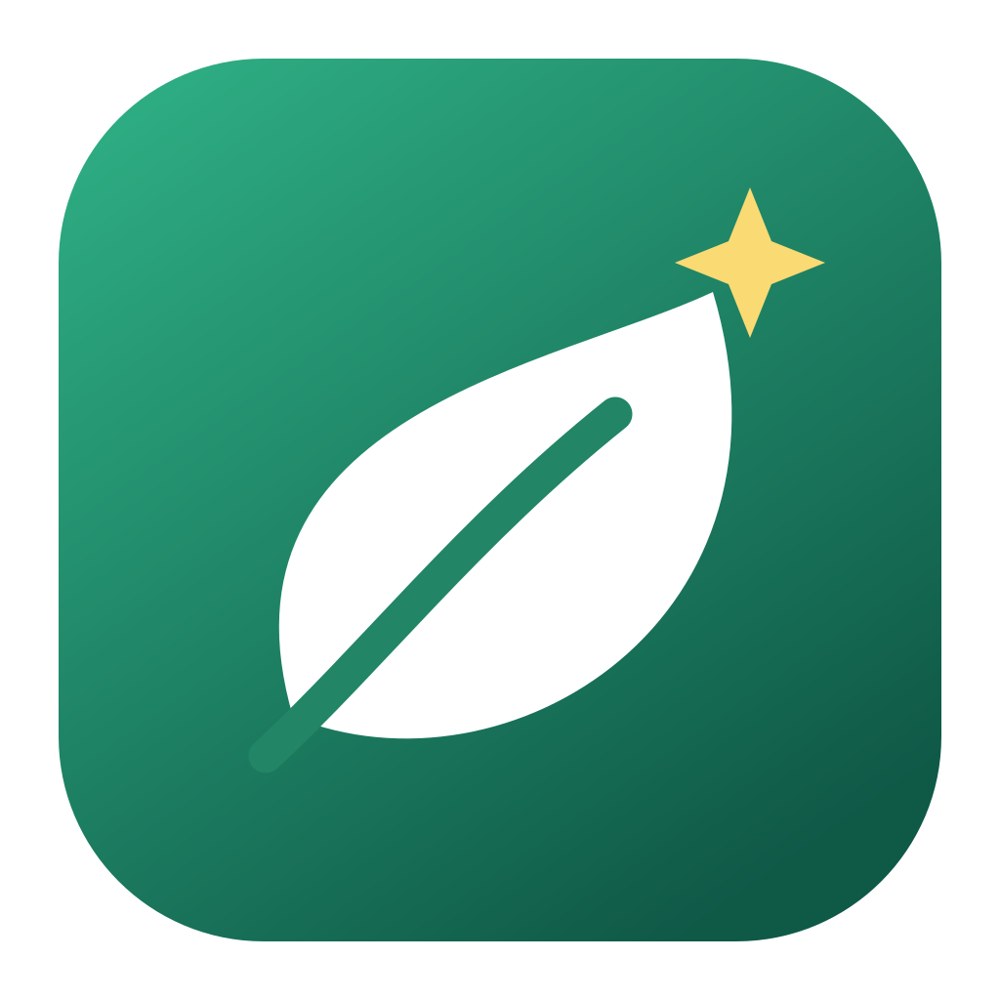

# MacGCleaner



Нативное приложение macOS для поиска старых кэшей, логов и сборок Xcode. Движок на Go, окно на SwiftUI/AppKit. Без браузера, WebView, Electron, веб-сервера, сетевых запросов и сторонних зависимостей.

Автор: **Кислов Роман Сергеевич** · [Apache License 2.0](LICENSE).

Независимый проект, не связан с CleanMyMac или MacPaw.

## Запуск

Готовый `.app` для **Apple Silicon (arm64)**: [скачать из Releases](https://github.com/rkislov/macgcleaner/releases/latest). Распакуйте ZIP и перенесите приложение в «Программы». Сборка подписана локально, без нотариализации Apple.

Готовое приложение после сборки: `build/MacGCleaner.app`.

```sh
./scripts/build.sh
open build/MacGCleaner.app
```

Требуются macOS 13+, Go 1.25+, Command Line Tools с Swift (`xcode-select --install`). Сборка для архитектуры текущего Mac. Подпись локальная ad hoc, не Developer ID и не нотариализация. Для распространения на другие Mac потребуется собственная подпись и нотариализация.

Приложение можно перетащить в «Программы». Запустите сканирование, выберите категории и отдельные объекты, при необходимости откройте их в Finder, затем нажмите «В Корзину» и подтвердите. Изначально ничего не выбрано. `⌘R` запускает повторное сканирование.

## Удаление программ

Раздел «Удаление программ» ищет сторонние `.app` непосредственно в `/Applications` и `~/Applications`. Показывает размер, идентификатор и состояние программы. Системные приложения Apple и сама утилита исключены. Программы внутри вложенных папок не перечисляются.

Раскройте «Связанные файлы» и отдельно отметьте нужные записи. Они ищутся по **точному bundle ID** в пользовательских `Caches`, `Logs`, `Preferences`, `Application Support`, `Saved Application State`, `HTTPStorages` и `WebKit`. Поиск намеренно консервативный: файлы с произвольными именами, общие контейнеры, привилегированные помощники и фоновые службы автоматически не удаляются. При нескольких копиях одной программы общие данные не предлагаются.

Связанные файлы могут содержать личные данные, настройки и сессии. Изначально они не выбраны. Закройте программу и обновите список перед удалением. Запущенные программы отклоняются повторно в момент очистки. Если перенос самой программы не удался, выбранные связанные данные сохраняются. Для программ, установленных с правами администратора, возможна ошибка доступа: приложение не повышает привилегии. У программ с собственным деинсталлятором используйте его для удаления служб и системных расширений.

Все выбранные объекты перемещаются в Корзину с возможностью восстановления. Если программа удалена, но часть связанных файлов перенести не удалось, эти файлы остаются в списке для повторного действия.

## Область очистки

- `~/Library/Caches`: объекты, не изменявшиеся минимум 7 дней.
- `~/Library/Logs`: объекты старше 30 дней.
- `~/Library/Developer/Xcode/DerivedData`: объекты старше 14 дней.

Каждая запись — файл или папка непосредственно внутри одной из этих категорий. Для папки проверяется возраст **всего дерева**, включая саму папку: один свежий файл исключает её целиком. Размеры логические; APFS, сжатие и клоны могут отличать их от фактически занимаемого места.

Документы, загрузки, приложения, системные каталоги, архивы Xcode и сама Корзина не очищаются. Ссылки, специальные файлы и объекты с недоступными вложениями исключаются. Пропуски показываются в отчёте, полного доступа к диску приложение не запрашивает. Пустой результат при наличии пропусков не означает, что проверен весь диск.

Перед очисткой закройте приложения, чьи кэши выбраны. Кэши могут содержать офлайн-данные; их повторное создание или загрузка потребует времени. Удаление DerivedData замедлит следующую сборку Xcode.

## Защита очистки

Go-процесс получает команды через приватные stdin/stdout-каналы дочернего процесса. HTTP-портов нет. Очистка принимает только случайные ID из последнего сканирования соответствующего раздела текущего процесса, а не произвольные пути. Перед переносом повторно проверяются дерево, ссылки в пути, inode, размеры и время изменения. Изменившиеся объекты пропускаются. Внутренние ссылки в `.app` учитываются как ссылки без обхода их целей: это позволяет корректно переносить framework-пакеты. Ссылки вместо самой программы или её родительской папки отклоняются. Между последней проверкой и системным переносом остаётся небольшое окно конкурентного изменения: это приложение для локальной уборки, не средство защиты от вредоносного процесса под тем же пользователем.

Файлы перемещаются штатным `NSFileManager.trashItemAtURL`, без `rm` и без привилегий администратора. Восстановить их можно из Корзины Finder. Пространство освободится **после самостоятельной очистки Корзины**. Приложение не опустошает её автоматически.

## Проверки

```sh
go test -race ./...
go vet ./...
```

Тесты используют временные каталоги и подменяют перенос в Корзину: реальные пользовательские файлы не удаляются. Проверяются возраст всего дерева, ссылки, смена inode и метаданных, подмена родительской папки, устаревшие ID, повторные команды и частичные ошибки.

Исходники: `internal/cleaner` — движок и небольшой мост к Foundation для Корзины; `cmd/cleaner` — JSON-протокол; `native/MacGCleaner.swift` — интерфейс; `scripts/build.sh` — сборка `.app`.

Механизм Корзины: [Apple NSFileManager documentation](https://developer.apple.com/documentation/foundation/filemanager/trashitem(at:resultingitemurl:)).

## Разработка и доступ

Публичный репозиторий: [rkislov/macgcleaner](https://github.com/rkislov/macgcleaner).

Issues и pull requests открыты для всех. Прямой доступ на запись и слияние PR — только у владельца `rkislov`; другие collaborators не добавляются. См. [CONTRIBUTING.md](CONTRIBUTING.md). Apache-2.0 разрешает независимые форки и модификации: это не ограничивается настройками основного репозитория.

Иконка «Leaf and Spark» нарисована векторными контурами: [исходник SVG](assets/AppIcon.svg), генератор macOS `.icns` — `native/BuildIcon.swift`. В приложение включены `LICENSE` и `NOTICE`.
